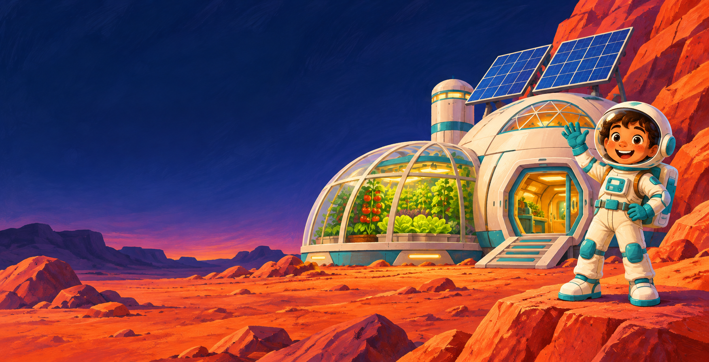

# Mars Base

Mars Base is a bilingual browser game that puts kids ages 7–12 in charge of a Martian outpost. Keep four astronauts supplied and sheltered for six sols. A sol is one day on Mars.

**NASA International Space Apps Challenge 2026**  
**Challenge:** Build a Junior Astronaut Mission Trainer  
**Team:** zirocooles · **Member:** Javier Canteros

## How to play

1. Download or clone this repository and open `index.html` in a browser.
2. Choose **English** or **Español** at the top of the page. You can switch languages during a mission.
3. Pick a plan and compare the illustrated **Now** and **Left** cards for battery power, water, and food. Select **Do it** to advance one sol.
4. Read what happened, then try a different plan on your next run.

The game runs locally without a server, an account, or an API key.

## The decisions you make

- **Power and food.** A dust storm reduces solar power. Keep the greenhouse lights on by drawing from the battery, or save that power and delay the lettuce harvest.
- **Water recycling.** Use less power by recycling less water. Your stored water runs out faster.
- **Shelter and communications.** During the solar alert, tap the shelter or swipe over the dusty panel to select a plan. In this scenario, a radio reply from Earth takes 20 minutes. Cleaning the panels helps tomorrow's power supply, while taking shelter reduces the crew's radiation exposure.

## Science behind the game

- A historical solar particle event from May 11, 2024 inspired the game’s solar alert. [NASA DONKI event record](https://ccmc.gsfc.nasa.gov/DONKI/view/Alert/30728/1)
- The Opportunity rover’s experience with dust inspired the drop in solar power during the storm. [NASA · On Mars, Light Is Energy](https://science.nasa.gov/resource/on-mars-light-is-energy/)
- The radio delay is based on the time it takes for a signal to travel between Earth and Mars. [NASA · How messages reach Perseverance](https://science.nasa.gov/blog/speaking-percys-language-how-to-talk-so-perseverance-will-listen/)
- The Canadian Space Agency’s growing guide informed the choice of leaf lettuce and the use of grow lights. [CSA · Interplanetary Farming](https://www.asc-csa.gc.ca/eng/youth-educators/activities/fitness-and-nutrition/interplanetary-farming.asp)

The game uses simplified resource and radiation points. The historical DONKI record is included as a reference for the scripted alert.

## Project demo

- [28-second demo video](Video-Presentacion/Mars-Base-zirocooles.mp4)
- [Five-slide PowerPoint](Video-Presentacion/Mars-Base-zirocooles.pptx)

## Project files

| Path | What it contains |
| --- | --- |
| `index.html` | Game interface and source links |
| `css/styles.css` | Responsive layout and animation styles |
| `js/game.js` | Mission rules, resource forecasts, sprite animations, and translations |
| `imagenes/` | Base artwork and animation frames |
| `Video-Presentacion/` | Video and slide deck |

Built with HTML, CSS, and JavaScript.

